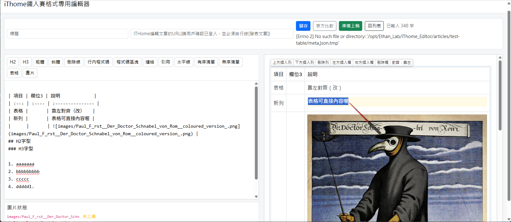
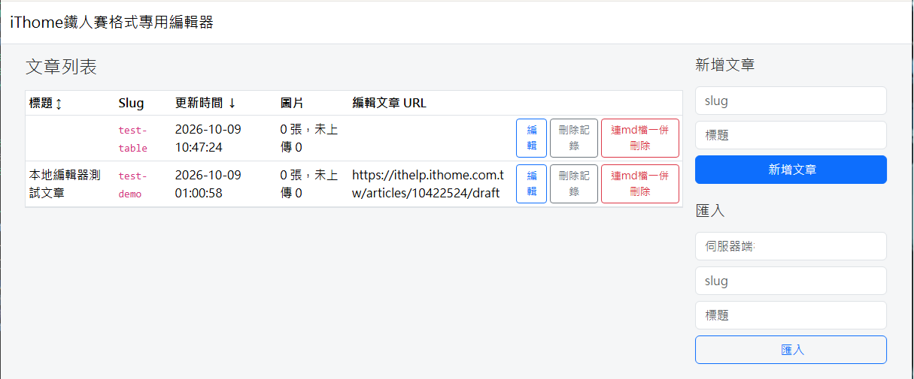

# iThome30day_Editor

iT邦幫忙鐵人賽文章的本地 Markdown 編輯器與機械化上稿工具。

在自己的電腦上寫稿、即時看到和發表後一模一樣的預覽、在預覽裡直接點表格修改、圖片自動上傳成官方連結，最後把成品貼進 ithelp 的草稿頁。**登入與發表永遠由你自己在瀏覽器完成**，工具不碰你的帳號密碼。

## 特色

- **預覽與官方一致**：本地 renderer 模擬 ithelp 伺服器端的 `/api/preview` 行為（單一換行即 `<br>`、HTML 標籤剝除、表格對齊、刪除線、裸 URL 自動連結），並以 ithelp 官方 CSS 與 694px 內文寬度呈現，換行位置與發表後相同。
- **表格所見即所得**：右側預覽裡的表格可直接點儲存格編輯，`Tab` 換格、最後一格 `Tab` 新增列；工具列可插入、刪除列欄與切換對齊。改動只會回寫左側 Markdown 中該表格對應的那幾行，Markdown 永遠是唯一真相。從試算表複製貼上含 Tab 的文字會自動轉成 Markdown 表格。
- **圖片自動上傳**：文章裡用 `` 引用本地圖片（支援按鈕選檔、拖放、剪貼簿貼上）。按「準備上稿」時透過你已登入的 Chrome 呼叫官方 `/api/upload`，自動替換成 `` 的官方格式，相同內容（SHA-256）不重複上傳。
- **全本地執行**：Web 介面只綁 `127.0.0.1`，所有前端資源隨 repo 附帶，沒有任何 CDN。

## 畫面

編輯畫面：左側 Markdown，右側與發表後一致的預覽，表格可直接在預覽裡點儲存格修改。



文章列表：



## 安全設計（刻意為之）

這個版本**刻意排除**任何與帳號登入有關的功能：

- 設定檔沒有帳號、密碼欄位，程式碼裡也沒有登入流程。
- 工具透過 Chrome 的遠端除錯埠（CDP）連到**你自己開啟、自己登入**的 Chrome 分頁，借用那個分頁的 cookie 呼叫官方 API。工具本身從頭到尾拿不到你的憑證。
- 工具只做兩件事：上傳圖片、把標題與內文填進草稿頁的編輯器。**「儲存草稿」與「發表文章」兩個按鈕永遠由你手動按下**，不會自動發表。
- 除錯埠只綁本機 `127.0.0.1:9222`，且使用獨立的 Chrome profile，和你平常的瀏覽器資料分開。

要信任一個會幫你發文的工具，前提是它沒有能力在你不知情時發文。這個版本就是照這個原則設計的。

## 運作方式

```
你（瀏覽器）                 iThome30day_Editor（本機）              ithelp
┌──────────────┐  編輯/預覽   ┌───────────────────────┐
│ 127.0.0.1:5451│ ◀────────▶ │ Flask + markdown-it-py │
└──────────────┘             │   articles/<slug>/     │
                             └──────────┬────────────┘
┌──────────────┐   CDP 9222             │ 上傳圖片、填入草稿
│ Chrome       │ ◀──────────────────────┘
│（你已登入）  │ ───────── 以你的 cookie 呼叫 /api/upload ────▶ ithelp
└──────────────┘
      │
      └── 你自己按「儲存草稿」或「發表文章」
```

## 安裝

需求：Python 3.12 以上、Google Chrome、可連上 ithelp 的網路（啟動時會下載官方 CSS 供預覽使用）。
Playwright 只用來連接既有的 Chrome，**不需要**執行 `playwright install`。

### Windows（原生，不需要 WSL）

1. 安裝 [Python 3.12+](https://www.python.org/downloads/windows/)，安裝時勾選「Add python.exe to PATH」。
2. 下載本 repo（`git clone` 或 Code → Download ZIP 後解壓）。
3. 雙擊 `start.bat`。第一次會自動建立 `.venv`、安裝套件、複製 `config.ini`，然後：
   - 以獨立 profile 啟動一個帶遠端除錯埠的 Chrome，並開啟 ithelp 首頁；
   - 啟動編輯器並在預設瀏覽器開啟 `http://127.0.0.1:5451/ithome/`。
4. 在那個新開的 Chrome 視窗登入 iT邦幫忙（只需第一次，profile 會記住）。

手動啟動 Chrome 的等價指令（PowerShell）：

```powershell
& "C:\Program Files\Google\Chrome\Application\chrome.exe" --remote-debugging-port=9222 --user-data-dir="$env:LOCALAPPDATA\iThome30day_Editor\chrome-profile" https://ithelp.ithome.com.tw/
```

### Linux / macOS

```bash
git clone https://github.com/ethan-beakmask/iThome30day_Editor.git
cd iThome30day_Editor
./start.sh
```

`start.sh` 做的事和 `start.bat` 相同。手動啟動 Chrome：

```bash
google-chrome --remote-debugging-port=9222 --user-data-dir="$HOME/.ithome30day_editor/chrome-profile" https://ithelp.ithome.com.tw/
```

### 不用啟動腳本的純手動安裝

```bash
python3 -m venv .venv
. .venv/bin/activate            # Windows: .venv\Scripts\activate
pip install -r requirements.txt
cp config.ini.example config.ini
python3 ithome_editor.py serve
```

### 關於 WSL

不需要 WSL，Windows 原生即可。若你堅持在 WSL 內執行，Chrome 仍要跑在 Windows 端，WSL 必須連得到 Windows 的 `9222` 埠；Windows 11 的 WSL mirrored networking 模式下 `127.0.0.1:9222` 可直接使用，否則需要自行設定 `netsh interface portproxy` 並把 `config.ini` 的 `cdp_url` 改成 Windows 主機 IP。

### 為什麼一定要 `--user-data-dir`

Chrome 136 起，對預設 profile 下的 `--remote-debugging-port` 會被**靜默忽略**（埠不會開，也不報錯），必須同時指定一個非預設的 `--user-data-dir`。這是 Chrome 的安全政策，也剛好符合本工具「獨立 profile」的設計。
確認埠有開：瀏覽器開 `http://127.0.0.1:9222/json/version` 應看到 JSON。

## 設定檔 `config.ini`

```ini
[ithome]
; 已登入 iT邦幫忙的 Chrome 遠端除錯埠（本機請用 127.0.0.1）
cdp_url = http://127.0.0.1:9222
site = https://ithelp.ithome.com.tw

[server]
; 基於安全考量只允許綁定 127.0.0.1
host = 127.0.0.1
port = 5451
prefix = /ithome
articles_dir = articles
log_file = logs/ithome_editor.log
```

## 使用流程

1. 開 `http://127.0.0.1:5451/ithome/`，新增文章或匯入既有的 `.md`／`.txt`。repo 內附兩篇示範文章 `demo-article`、`demo-table`。列表上的「刪除記錄」只移除列表項目，檔案留在 `articles/<slug>/`；「連md檔一併刪除」會整個目錄刪掉，兩者都會先跳確認。
2. 左側寫 Markdown，右側即時預覽。圖片用按鈕、拖放或貼上，會存到 `articles/<slug>/images/` 並插入引用。
3. 表格直接在預覽裡點儲存格修改：`Enter` 確認、`Esc` 取消、`Tab` 下一格。
4. 到 ithelp 建立或打開一篇草稿，把網址（形如 `https://ithelp.ithome.com.tw/articles/<id>/draft`）填進編輯頁的「草稿 URL」。
5. 按「準備上稿」：上傳圖片 → 產生 `article.published.md` → 把標題與內文填進草稿頁的編輯器。
6. 切到 Chrome 檢查後，**自己按**「儲存草稿」或「發表文章」。

### 文章資料

```
articles/<slug>/
├── article.md            # 你的稿子（唯一真相）
├── meta.json             # 標題、草稿 URL、時間
├── images/               # 本地圖片
├── uploads.json          # 已上傳圖片的官方 URL 與 SHA-256
└── article.published.md  # 圖片已替換成官方 URL 的最終稿
```

## 命令列

```bash
python3 ithome_editor.py                       # 顯示中文說明
python3 ithome_editor.py serve [--port 5451] [--refresh-css]
python3 ithome_editor.py list
python3 ithome_editor.py new day-01 --title "第 1 天"
python3 ithome_editor.py import 舊稿.txt --slug day-02 --title "第 2 天"
python3 ithome_editor.py render day-01 -o preview.html
python3 ithome_editor.py check day-01 --draft-url https://ithelp.ithome.com.tw/articles/<id>/draft
python3 ithome_editor.py publish day-01 --draft-url https://ithelp.ithome.com.tw/articles/<id>/draft
```

`check` 會把本地渲染結果與官方 `/api/preview` 的輸出逐行比對，用來驗證 renderer 是否仍與官方一致。

## 官方 Markdown 規則對照

| 項目 | 官方行為 |
|:--|:--|
| 單一換行 | 變成 `<br>` |
| 原始 HTML | 標籤被剝除，標籤內文字保留 |
| `#標題` 不空格 | 不是標題 |
| 表格對齊 | `---` 無對齊屬性且預設置中；要靠左必須寫 `:--` |
| 刪除線 `~~x~~` | `<del>x</del>` |
| 裸 URL | 自動連結 |
| 程式碼區塊 | ```` ```lang ```` 會輸出 `language-lang` class |
| 不支援 | 任務清單、註腳、數學公式、emoji 代碼 |

## 常見錯誤

| 訊息 | 處理 |
|:--|:--|
| 無法連線 Chrome 遠端除錯埠 | 確認 Chrome 以 `--remote-debugging-port=9222 --user-data-dir=...` 啟動，`http://127.0.0.1:9222/json/version` 有回應 |
| 尚未登入 iT邦幫忙 | 在那個 Chrome 視窗登入 ithelp 後重試 |
| 缺少草稿 URL | 先在編輯頁填入草稿 URL，或 CLI 加 `--draft-url` |
| 圖片超過 5MB | 官方上傳上限 5MB，請先壓縮 |
| 需要網路連線以取得 iT邦幫忙的樣式檔 | 第一次啟動需連網下載官方 CSS 到 `static/ithelp_cache/`，之後離線可用舊檔 |

## 開發

```bash
pip install -r requirements-dev.txt
python3 -m pytest tests -q
```

`tests/fixtures/sample.official.html` 是官方 `/api/preview` 的實際輸出，renderer 測試以它為基準。

## 第三方資源

前端資源（Bootstrap、Alpine.js、highlight.js、Lato 字型）隨 repo 附帶，授權見 `THIRD_PARTY_NOTICES.md`。
iT邦幫忙的 `style.css` 與 `railscasts.css` 屬 iThome 所有，**不隨 repo 散佈**，由程式啟動時從官方站下載到 `static/ithelp_cache/`，僅供本機預覽。

## 授權

MIT，見 `LICENSE`。
